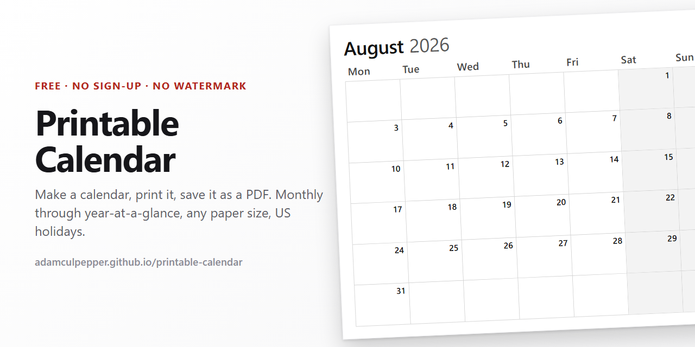

<p align="center">
  
</p>

<h1 align="center">Printable Calendar</h1>

<p align="center">
  A free printable calendar maker that produces clean PDFs straight from your browser.<br>
  No sign-up, and nothing on the page but the calendar.
</p>

<p align="center">
  <a href="https://adamculpepper.github.io/printable-calendar/"><b>Open the calendar maker</b></a>
</p>

<p align="center">
  
  
  
  
  
</p>

---

Most printable calendar sites hand you a PDF with their own logo on it, or a layout that leaves
half the page empty. This one gives you the grid and as much blank writing space per day as the
paper allows. Nothing else reaches the paper.

Pick a year, a starting month and how many months you want. Choose monthly, two months, four
months, six months, or the whole year on a single sheet. Set the paper size, turn on US holidays
if you want them, then print. Everything you set is in the address bar, so a calendar you like is
a link you can bookmark or send to someone.

## What you can make

- **Monthly**, one month per page, with the biggest day cells the sheet will give you
- **Quarterly and half-year**, two, four or six months per page
- **Year at a glance**, all twelve months on one sheet
- **Blank**, with the grid turned off, if you would rather rule your own
- **2025, 2026, 2027** or any year you type in, starting from any month
- **Letter, Legal, 11x17, A4** and two poster sizes, landscape or portrait
- **Monday-start or Sunday-start** weeks
- **US federal holidays** plus common observances, or none at all

Print to paper, or choose "Save as PDF" in the print dialog and you have a PDF calendar. There is
also a download that saves the whole thing as one HTML file you can keep or print later.

## Why it prints correctly

Printing from a web page usually goes wrong in the same few ways. You get a blank page at the end,
a grid that stops two inches short of the bottom, or a month split across two sheets. Most of that
comes from one mistake, which is sizing the page against the browser window. In a print context the
window is not the page.

So none of the layout here is measured against the viewport. Paper sizes are defined in exact
millimeters, the printable area is the sheet minus its margins, and every band inside it gets
subtracted from that in absolute units. The day grid is handed an explicit height and its weeks
divide it equally, which is why a five-row month fills the sheet to the same bottom edge as a
six-row month, with taller cells.

A few other things that matter once ink hits paper:

- Grid lines are borders, never background fills, so they still print when "Background graphics" is
  off in the print dialog
- Weekend shading is derived from the grid color's luminance, so the lines stay visible through
  it. A mid gray fill over a mid gray hairline is why shading looks broken on a lot of printable
  calendars
- Only the sheets between pages force a page break, which is what stops the blank thirteenth page
  at the end of a twelve month run
- The sheet is centered on the paper, so it prints identically whether the dialog's margins are set
  to Default or None
- Type is sized against the cell it lands in, using proportions measured off a printed reference
  rather than guessed

## Verified against real print output

Claims about print output are worth very little unless something actually prints, so the test
harness drives real headless Chrome over the DevTools protocol, asks it for a PDF the same way
"Save as PDF" does, and checks the bytes that come back.

```bash
npm install
npm run verify       # 24 configurations plus the download path
npm run verify:full  # every calendar type x orientation x paper size
```

Each case asserts that the PDF has exactly the expected page count with no blank trailer, that
every sheet measures the paper size requested (checked in PDF points), that nothing overflows,
that content reaches the bottom margin, and that the rows came out equal height. Date arithmetic is
checked separately, including leap years, both week starts, and every month from 2024 through 2028.
Easter is checked against dates a real calendar agrees on.

The full matrix is **80 configurations and 700 assertions**, and it has caught real bugs twice:
once when a stylesheet reorganization made every downloaded multi-month calendar a page too long,
and once when a layout change quietly printed the sidebar onto every sheet.

## Running it locally

```bash
npm install     # holidate, plus browser-sync and pdf-lib for local dev and verification
npm run vendor  # regenerates vendor/holidate/holidate.js from the installed package
npm start       # serves the app at http://localhost:3000
```

It uses ES modules, so it needs to be served over HTTP. Opening `index.html` off the filesystem
will not work, because Chrome blocks module scripts on `file://`.

## Options

| Option | Values |
| --- | --- |
| Calendar Type | Monthly, Two Month, Four Month, Six Months, Yearly |
| Year | 2025, 2026, 2027, or anything you type |
| Starting Month | Any month. The run rolls over the year boundary. |
| Months to Print | 1 to 120 |
| Orientation | Landscape or Portrait |
| Paper Size | Letter, 11x17, Legal, Poster, Movie Poster, A4 |
| Weekday Starts | Sunday or Monday |
| Weekends Shaded | Yes or no |
| Grid Lines | On or off, gray, black or a custom color |
| Notes | Ruled column beside the grid, or a strip along the bottom |
| Adjacent Days | Hide, or print the neighboring months' dates grayed out |
| Holidays | Off, US federal only, or federal plus common observances |
| Title Font / Body Font | System, or any of 17 Google families |
| Title / Weekday / Date / Holiday Size | Five steps, scaling the measured defaults |

## Fonts

Type is set in the system font stack by default, and nothing is fetched in that state. Pick a family
and the page adds a link to Google Fonts for the one or two families in use.

Every stack ends in the system fonts, so a blocked or missing network degrades to the original
typography rather than to nothing. The Print button waits on `document.fonts.ready` before opening
the dialog, because Chrome will otherwise print a page whose webfont is still in flight and put
fallback metrics on the paper.

Sizes are scales, not absolute values. Each control multiplies the measured default, so type keeps
adapting to the paper and the cell, and no combination can produce a sheet that does not fit.

## Holidays

Holiday dates come from [holidate](https://github.com/zachnology/holidate), an MIT-licensed library
by Zachary Gomez, installed from npm and vendored into `vendor/holidate/holidate.js` by
`npm run vendor`. The copyright notice in the generated file is lifted from the upstream license
rather than retyped.

holidate covers the United States only, which is why the Holidays control is US only. It handles
the observed-date rule, so you will see both June 19 2027 and the Friday before it marked, because
Juneteenth falls on a Saturday that year.

Two things are corrected on the way through. Easter is recomputed, because holidate derives it from
a fixed golden-number table with no century correction, which is right for roughly 1900 to 2199 and
wrong outside it. And where two holidays share a date the federal one wins the cell, because June
19 2022 was both Juneteenth and Father's Day and it printed as Father's Day.

## Assumptions

Worth stating plainly, since the reference sites do not publish their own.

Poster is taken as 18 x 24 in, and Movie Poster as 27 x 40 in, the US one sheet. Neither has a
single standard, so both live in `PAPER_SIZES` in `js/config.js` if you want different numbers.

Margins are 0.35 in. The point of this calendar is writing space.

Download HTML saves a self-contained file, not a PDF. Generating a real PDF would mean pulling in a
PDF library, and the browser already makes better ones. Print is the PDF path.

## What reaches the network

Two things: a font, if you pick one other than System, and Google Analytics. Neither affects what
prints, and neither goes into the downloaded file.

## License

MIT. Do what you like with it, including commercially, as long as the copyright notice comes
along. See [LICENSE](LICENSE).

The vendored holiday data keeps its own MIT notice in `vendor/holidate/LICENSE.md`.

## Files

```
index.html                     markup shell
css/app.css                    the options panel, screen only
css/calendar.css               the printed artifact, screen preview and print
js/analytics.js                Google Analytics config
js/config.js                   paper sizes, calendar types, fonts, defaults
js/date-utils.js               month grids, week starts, leap years, rollover
js/holidays.js                 adapter over vendored holidate, date-keyed lookups
js/layout.js                   page box arithmetic, the @page rule, type scales
js/render.js                   DOM generation
js/controls.js                 the tabbed options panel and the URL round trip
js/app.js                      wiring, fonts, print, download
scripts/lib/browser.mjs        static server, headless Chrome, minimal CDP client
scripts/vendor-holidate.mjs    npm package to browser module
scripts/verify-print.mjs       headless Chrome, real PDFs, assertions
scripts/capture-preview.mjs    PNG renders for eyeballing
scripts/build-social-images.mjs  share images, rendered from the real app
vendor/holidate/               generated, MIT, do not edit by hand
```
